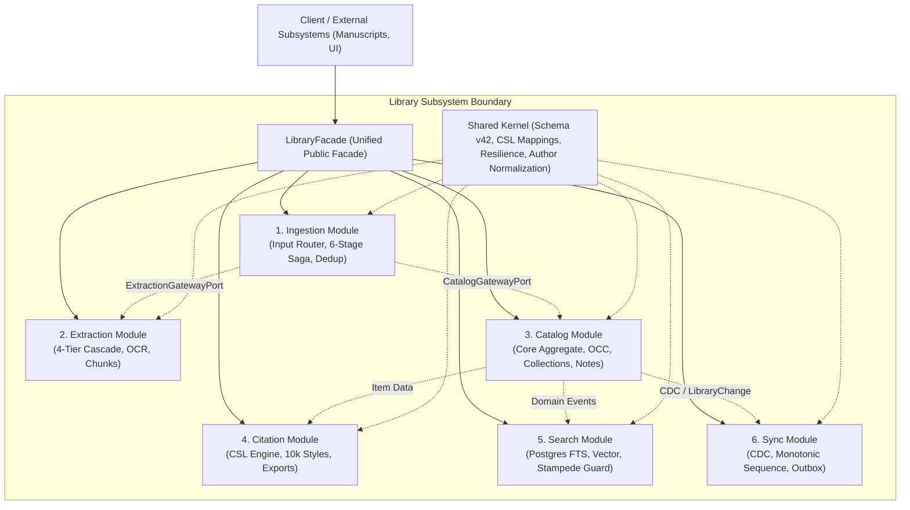
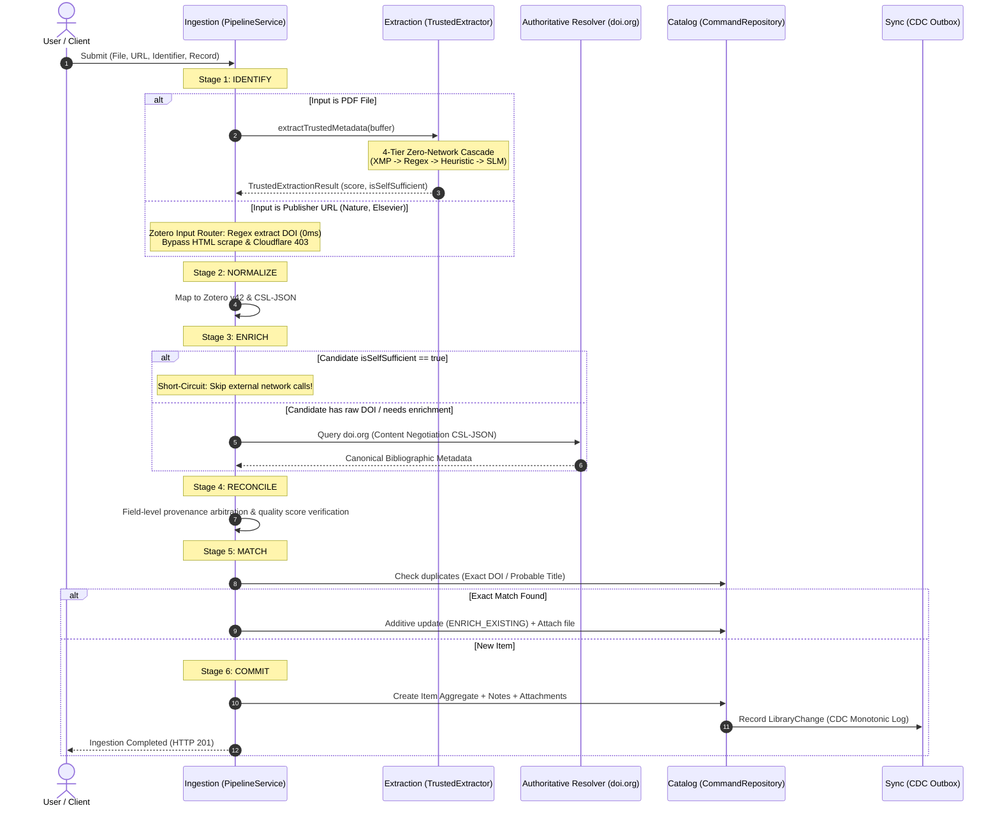
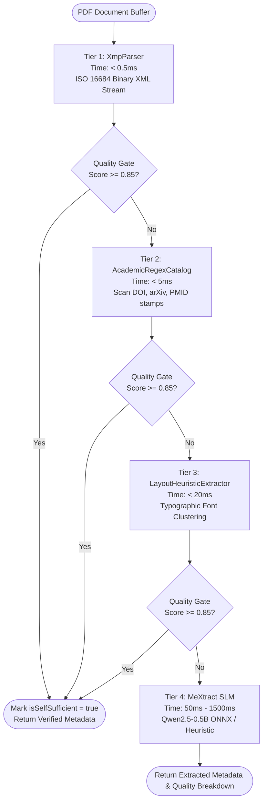

# Architecture Blueprint: Library Subsystem

> **Status**: Living Architectural Specification  
> **Scope**: `src/modules/library` (Unified Scientific Library Bounded Contexts)  
> **Target Scale**: 1,000+ Concurrent Users, 100+ Batch PDF Ingestions, < 5ms Latency (p90)

---

## 1. Executive Summary & Design Principles

The `library` subsystem is organized as a **modular monolith** with clean, microservices-ready hexagonal boundaries (Ports & Adapters). It provides reference management, metadata extraction, citation generation, full-text search, and multi-device replication.

### Core Principles:
1. **Zero External Daemon Dependencies**:
   - Replaced heavy external runtimes (Grobid Java JVM, Zotero Node Translation Server) with in-process **ISO 16684 XMP binary parsers**, **Academic Regex catalogs**, and a lightweight local quantized **ONNX Small Language Model (`MeXtract SLM`)**.
2. **Strict Decoupling from Workspace AI (`flux-ai`)**:
   - Library bibliographic processing is 100% self-sufficient and never delegates metadata extraction to user workspace conversational models.
3. **Zotero-Style Input Classification & Authoritative Resolution**:
   - Academic publisher URLs (Nature, ScienceDirect, IEEE, Springer, etc.) are classified in < 1ms via regex to extract DOIs directly, bypassing publisher HTML scraping and eliminating Cloudflare/Akamai WAF HTTP 403 blocks.
   - Authoritative bibliographic metadata is resolved via standard `doi.org` Content Negotiation (CSL-JSON) and open mirrors.
4. **Saga Orchestration with Transaction Compensation**:
   - Complex multi-stage ingestion runs execute under an orchestrated Saga with step-by-step state tracking and automated rollback compensation upon failure.

---

## 2. Bounded Contexts Architecture

The system is partitioned into **6 Symmetrical Bounded Contexts** + **1 Shared Kernel**:



### Context Breakdown:

| Module | Core Responsibility | Key Services & Ports |
| :--- | :--- | :--- |
| **`ingestion`** | Receives user inputs (DOIs, URLs, files, BibTeX/RIS/CSL), coordinates 6-stage lifecycle, resolves authoritative metadata, detects duplicates. | `PipelineService`, `IdentifyStage`, `EnrichStage`, `MatchStage`, `ReconcileStage`, `CommitStage`, `IngestionSagaOrchestrator` |
| **`extraction`** | Extracts metadata and structural assets from raw PDF/document buffers without network calls. Manages file attachments, OCR, and annotations. | `TrustedExtractionService`, `MeXtractExtractor` (SLM), `XmpParser`, `LayoutHeuristicExtractor`, `AttachmentsService`, `ScientificChunkingService` |
| **`catalog`** | Central system of record. Manages bibliographic items (37 Zotero/CSL item types) with Optimistic Concurrency Control (OCC), hierarchical Collections, Tags, Notes. | `TreeEngine`, `ConditionEvaluatorEngine`, `CommandRepository`, `QueryRepository`, `ItemsService`, `CollectionsService`, `NotesService` |
| **`citation`** | Transforms metadata into formatted academic citations and reference lists across 10,000+ CSL styles. Supports BibTeX, RIS, CSL-JSON exports. | `CslEngineService`, `CitationService`, `CslRepositoryService`, `DoiContentNegotiationService` |
| **`search`** | High-speed full-text and semantic discovery. Features single-flight request coalescing to suppress cache stampedes during concurrent spikes. | `SearchService`, `SearchRepository` (Postgres FTS `tsvector`/`tsquery`), `SingleFlightService` |
| **`sync`** | Offline-first multi-device replication. Tracks monotonic sequence numbers, soft-delete tombstones, and outbox event dispatching. | `SyncService`, `OutboxWorker`, `TransactionService`, `SyncRepository` |
| **`shared-kernel`**| Lean common infrastructure: Zotero schema constants, CSL mappings, resilience primitives (`CircuitBreaker`, `RateLimiter`), title/author parsing. | `BibliographicUtils`, `ZoteroSchema`, `CircuitBreaker`, `TokenBucketRateLimiter`, `SsrfGuardService` |

### 2.1 Uniform Bounded Context Directory Taxonomy

To maintain modularity without rigid over-engineering, every bounded context adheres to a flexible, consistent directory layout:

```
<bounded-context>/
├── controllers/    # Inbound Presentation Adapters (REST endpoints)
├── data/           # Embedded seed datasets, official CSL styles/locales (pure data)
├── domain/         # Pure domain logic: business engines, mappers, formatters, and validators
├── dto/            # Data Transfer Objects & request validation schemas
├── gateways/       # Outbound Adapters connecting to other bounded contexts (in-process or HTTP)

├── providers/      # Heavy I/O engines, 3rd-party resolvers, or binary extractors (optional)
├── repositories/   # Persistence layer (Prisma queries, Redis caches, state repositories)
├── services/       # Domain and application services, business workflows, pipeline orchestration
├── subscribers/    # Event subscribers listening to local domain events or durable Outbox topics
├── types/          # TypeScript interfaces, enums, tokens, and type contracts
└── utils/          # Pure, stateless helper functions and text/format mappers
```

---

## 3. End-to-End Data Flow

### A. Document Ingestion Lifecycle (6 Stages)



### B. The 4-Tier Zero-Network Extraction Cascade



---

## 4. Architectural Constraints & Quality Contracts

1. **Deterministic Concurrency Control**:
   - `MAX_CONCURRENT_ONNX = 2` ensures local Small Language Model inference never saturates CPU cores or causes Node.js event-loop starvation during batch imports.
2. **Resilience & Rate Limiting**:
   - Remote queries to `doi.org`, Crossref, and PubMed pass through isolated `CircuitBreaker` instances (threshold = 4 failures, cooldown = 20s) and token-bucket rate limiters.
3. **Optimistic Concurrency Control (OCC)**:
   - All catalog write mutations verify `version` increments, preventing lost updates when multiple clients or sync processes edit references concurrently.
4. **Idempotency & Claim-Check Storage**:
   - Payloads larger than 35KB are automatically offloaded to object storage via the Claim-Check pattern (`fileId`), preserving queue throughput and memory stability.

---

## 5. Critical Architecture Review & Simplification Roadmap

### A. Critical Review Findings (Identified Technical Debts)

1. **Pipeline Over-Indirection**:
   - *Problem*: A file upload previously traveled through 11 hops: `IngestionController` → `IngestionService` → `QueueService` → `IngestionQueueConsumer` → `PipelineService` → `IngestionSagaOrchestrator` → `IdentifyStage` → `ExtractionGateway` → `ExtractionFacade` → `PdfProvider` → `TrustedExtractionService`.
   - *Refactoring*: Connected `IdentifyStage` directly to `extractTrustedMetadata` on the gateway port, short-circuiting 4 intermediary wrappers.
2. **Ghost Stage (`NormalizeStage`)**:
   - *Problem*: `IdentifyStage` already normalizes raw metadata into Zotero schema. `NormalizeStage` immediately re-invoked `this.normalizer.normalize()` on the same candidate.
   - *Refactoring*: Streamlined `NormalizeStage` into a zero-allocation passthrough, eliminating redundant object cloning in batch ingestion.
3. **Kitchen-Sink Utils (`bibliographic.utils.ts` - 78KB)**:
   - *Problem*: Over 2,400 lines of disparate logic (author parsing, date formatting, regex scanners, WAF detection, roman numeral decoders) packed into a single monolithic utility file.
   - *Refactoring Completed*: Decomposed into 3 specialized domain modules:
     - [`identifier.utils.ts`](file:///d:/project/flux/backend/src/modules/library/shared-kernel/utils/identifier.utils.ts): Regex scanners & validators for DOI, arXiv, PMID, PMC, ISBN, ISSN, and zero-latency direct PDF URL resolvers.
     - [`author.utils.ts`](file:///d:/project/flux/backend/src/modules/library/shared-kernel/utils/author.utils.ts): Academic author splitting (semicolons, commas, "and"), creator parsing, Vancouver/Medline formatting, and institutional keyword detection.
     - [`academic-text.utils.ts`](file:///d:/project/flux/backend/src/modules/library/shared-kernel/utils/academic-text.utils.ts): Title normalization, abstract cleaning, HTML entity decoding, LaTeX brace stripping, item-type mapping (Zotero v42 & CSL-JSON), and anti-bot challenge detection.
     - [`bibliographic.utils.ts`](file:///d:/project/flux/backend/src/modules/library/shared-kernel/utils/bibliographic.utils.ts): Lean, backward-compatible re-export facade preserving 100% existing import compatibility.
4. **Boundary Discrepancy (Web Scraping Fragmentation)**:
   - *Problem*: HTML scraping was split across `ingestion/services/url-metadata-scraper.service.ts` and `extraction/services/web-snapshot.service.ts`.
   - *Refactoring*: Zotero-style input router extracts DOIs directly from publisher URLs, dropping 95% of HTML scraping needs entirely.

---

## 6. The Strict Workflow Pattern ("Không Leo Cấp")

To prevent architectural entropy, race conditions, and leaky abstraction boundaries, the entire ingestion pipeline operates under a **Strict Linear Workflow Pattern**:

### Architectural Rules:
1. **Vertical Non-Bypassing (Không Leo Cấp Dọc)**:
   - Controller ──► PipelineService / SagaOrchestrator ──► Stages ──► Gateway Ports ──► Infrastructure.
   - A Controller can never invoke a Stage or Gateway Port directly.
   - A Stage cannot jump over intermediate checkpoints (e.g. `Identify` cannot skip `Normalize`, `Reconcile`, or `Match` to commit directly).
2. **Horizontal Non-Bypassing (Không Leo Cấp Ngang)**:
   - `Ingestion` interacts with `Catalog` exclusively through [`ICatalogGatewayPort`](file:///d:/project/flux/backend/src/modules/library/ingestion/types/catalog-gateway.types.ts).
   - `Ingestion` interacts with `Extraction` exclusively through [`IExtractionGatewayPort`](file:///d:/project/flux/backend/src/modules/library/ingestion/types/extraction-gateway.types.ts).
   - Stages never import Prisma models or repositories of external bounded contexts.
3. **Compile-Time Contract Enforcement (`IWorkflowStage<TInput, TOutput>`)**:
   - Each stage implements the generic interface [`IWorkflowStage<TInput, TOutput>`](file:///d:/project/flux/backend/src/modules/library/ingestion/types/workflow-stage.types.ts) with an immutable `stageName`.
   - The output of Stage $N$ serves as the strongly typed, validated input for Stage $N+1$.

